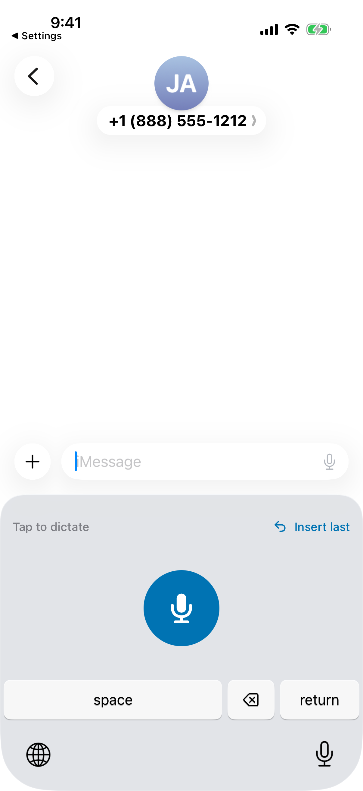
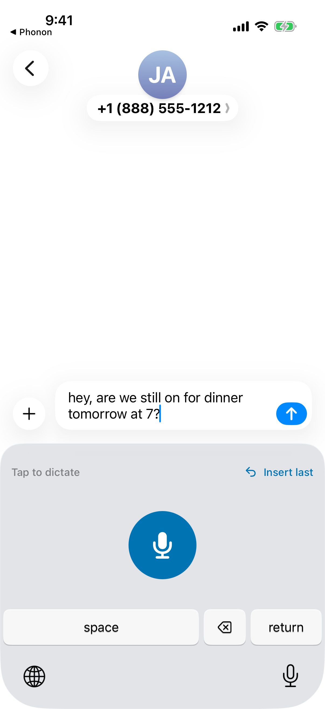
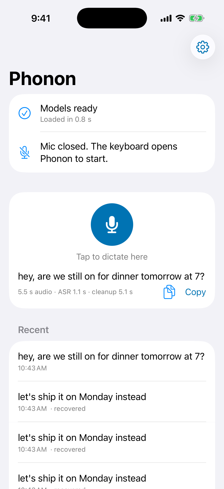
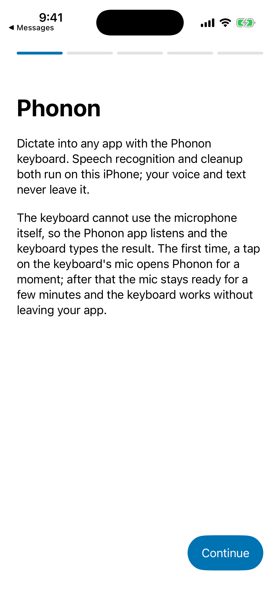
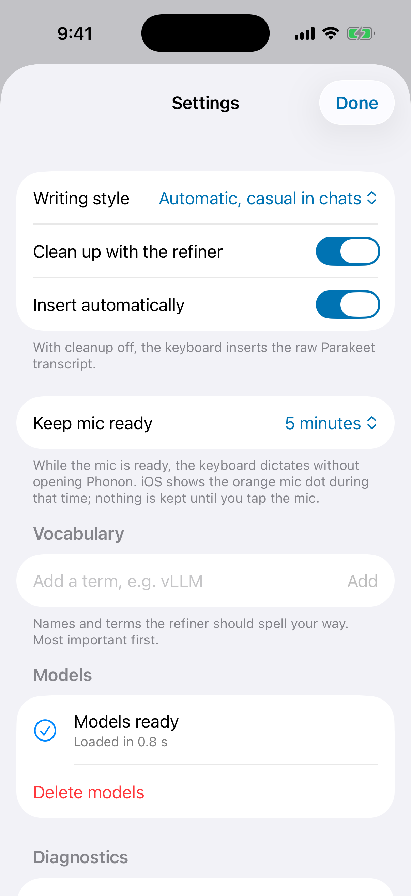

<h1 align="center">Phonon for iPhone</h1>

<p align="center">
A dictation keyboard for iPhone that turns your voice into clean text on the phone itself, with
<a href="https://github.com/Infatoshi/phonon">Phonon</a>'s speech and cleanup models.
</p>

<p align="center">
  <picture>
    <source media="(prefers-color-scheme: dark)" srcset="docs/shots/keyboard-messages-dark.png">
    
  </picture>
  &nbsp;
  
  &nbsp;
  <picture>
    <source media="(prefers-color-scheme: dark)" srcset="docs/shots/home-dark.png">
    
  </picture>
</p>

You talk, Parakeet writes down what you said, and the Phonon refiner fixes what speech
recognition gets wrong: misheard technical terms, restarts like "Friday, no wait, Monday", and
filler words. Both models run on the iPhone, and after the one-time model
download the app makes no network requests.

| You say | Parakeet hears | Phonon types |
| --- | --- | --- |
| "Let's ship it on Friday, no wait, let's ship it on Monday instead" | Let's ship it on Friday, no wait, let's ship it on Monday instead | let's ship it on Monday instead |
| "Um, so I think, uh, the build is broken because the cache is stale" | Um, so I think, uh, the build is broken because the cash is stale | I think the build is broken because the cash is stale |
| "Can you run the CUDA kernel benchmark with vLLM on the H100 tonight" | Can you run the CUDA kernel benchmark with VLLM on the H100 tonight | can you run the CUDA kernel benchmark with vLLM on the H100 tonight |

These are three of the four test recordings in `Fixtures/`, run through both models in the
simulator (`PhononTests/FixturePipelineTests.swift`). Across all four, the word error rate goes
from 0.38 on the raw transcript to 0.07 after cleanup.

This is a port of [Phonon](https://github.com/Infatoshi/phonon), Elliot Arledge's open-source
dictation app for macOS, to iOS. It uses the same models, the same refiner prompt and the same
output guard as the Mac app, and a test checks that the Swift port of the prompt and guard gives
the same answers as the Mac app's Python.

## How it works

```
 Messages (or any app)                         Phonon app (background, mic open)
 ┌──────────────────────────┐   Darwin note    ┌─────────────────────────────────────┐
 │ Phonon keyboard          │ ───────────────▶ │ AVAudioEngine, 16 kHz mono           │
 │  mic / stop / cancel     │   command.json   │   │                                  │
 │  insert last             │                  │   ▼                                  │
 │                          │                  │ Parakeet TDT 0.6B v2, Core ML (ANE)  │
 │  insertText(result)  ◀───┼──────────────────│   │                                  │
 └──────────────────────────┘  app-state.json  │   ▼                                  │
             App Group folder on the phone     │ Phonon refiner 1.7B, llama.cpp (CPU) │
                                               └─────────────────────────────────────┘
```

- **The keyboard never records.** iOS gives keyboard extensions no microphone, with or without
  Full Access. The keyboard sends start, stop and cancel to the app and types what comes back.
- **The app keeps the mic ready for a few minutes.** The first tap opens Phonon, which starts
  recording; you go back with the app name at the top left and keep talking. After that the mic
  stays open in the background (iOS shows the orange dot), so later taps work without leaving
  your app. You choose how long in Settings: 1, 5, 15 or 60 minutes. Music keeps playing.
- **Both models run in the background.** Parakeet runs on the CPU and Neural Engine. The refiner
  runs on the CPU, because iOS does not let background apps use the GPU.
- **A crash does not lose a dictation.** Audio goes to disk while you talk and a journal tracks
  each dictation. If the app is killed mid-dictation, the next launch finishes it and puts it
  under Insert last.
- **Cleanup can fail safely.** If the refiner errors, Phonon types the raw transcript. Its output
  also goes through the Mac app's word-count guard, which catches answers that drop or invent
  too much.

<p align="center">
  <picture>
    <source media="(prefers-color-scheme: dark)" srcset="docs/shots/onboarding-1-welcome-dark.png">
    
  </picture>
  &nbsp;
  <picture>
    <source media="(prefers-color-scheme: dark)" srcset="docs/shots/settings-dark.png">
    
  </picture>
</p>

The screenshots switch between light and dark with your GitHub theme. Every one is from the
iOS simulator at the phone's actual pixels.

## Install

There is no App Store or public TestFlight build. You build it with Xcode and install it on
your own phone.

Needs: a Mac with Xcode 26, an Apple Developer account, and an iPhone on iOS 17 or later. Cleanup
needs an A15 chip or newer (iPhone 13 and later); on older phones the keyboard types the raw
transcript.

```sh
brew install cmake xcodegen
git clone https://github.com/abhaymettu/phonon-ios && cd phonon-ios

# Use your own bundle id prefix and App Group instead of com.abhaymettu.
git grep -l com.abhaymettu | xargs sed -i '' 's/com\.abhaymettu/com.example/g'

scripts/vendor.sh                              # builds llama.cpp and FluidAudio into Vendor/
PHONON_TEAM=<your team id> scripts/export-ipa.sh   # signed development build in build/Phonon.ipa
```

Then install `build/Phonon.ipa` on the phone: connect it by cable with Developer Mode on
(Settings > Privacy & Security > Developer Mode), and in Xcode open Window > Devices and
Simulators, select the phone, and drag the .ipa onto Installed Apps. You can also open
`Phonon.xcodeproj` (made by `xcodegen generate`), pick your team under Signing & Capabilities,
and run on the phone.

On the phone:

1. Open Phonon and follow the five setup screens: microphone, the model download (1.45 GB, use
   Wi-Fi), and the keyboard.
2. Settings > General > Keyboard > Keyboards > Add New Keyboard > Phonon. Tap Phonon and turn on
   Allow Full Access, which lets the keyboard talk to the app through their shared folder.
3. In any text field, hold the globe key, pick Phonon, and tap the mic.

## Models

Downloaded on first run from Hugging Face, pinned to exact commits and checked byte for byte
(sha256 per file, in `PhononCore/Sources/PhononCore/ModelManifest+Pinned.swift`). A dropped
download picks up where it stopped.

| Model | Size | License |
| --- | --- | --- |
| [Parakeet TDT 0.6B v2, Core ML](https://huggingface.co/FluidInference/parakeet-tdt-0.6b-v2-coreml) @ `ee09c56` | 464 MB | CC BY 4.0 |
| [Phonon refiner 1.7B](https://huggingface.co/Infatoshi/phonon-refiner-1.7b) @ `2b0ab74`, `Q4_K_S` GGUF | 988 MB | LFM Open License v1.0 |

The Mac app's speculative-decoding drafter is left out. Phonon checks its drafter against plain
greedy decoding, so it changes speed, not text.

## What has been measured

| What | Where | Result |
| --- | --- | --- |
| Word error rate, 4 test recordings | simulator | 0.38 raw, 0.07 after cleanup |
| Speech recognition per recording | simulator | 1.1 to 1.6 s |
| Cleanup per recording | simulator | 5.8 to 6.7 s |
| Keyboard tap to text in Messages, end to end | simulator | passes; stop to text 5 to 9 s |
| Model load after the first launch | simulator | 0.8 s |
| Full app and keyboard, dictating in Messages | an iPhone, through private TestFlight | works |

The simulator runs both models on the Mac's CPU, without the phone's Neural Engine or its memory
limits, so its timings are not phone timings. To measure your phone, open Settings > Self-test and device limits > Run
self-test. It runs the bundled recordings through both models and saves a report to
Files > On My iPhone > Phonon.

Known limits:

- English only (Parakeet TDT 0.6B v2).
- The first tap after the ready window ends opens Phonon for a moment; iOS does not let a
  keyboard start the microphone.
- The app needs Full Access for the keyboard, because the keyboard and app share results
  through an App Group folder.
- The first launch after an install compiles the speech model for the Neural Engine, which
  takes longer than later launches.

## Build and test

[AGENTS.md](AGENTS.md) has every command: unit tests, simulator tests through both models, the
keyboard flow test in Messages, regenerating the golden cases and the model manifest, and the
simulator's Core ML cache, which can fill a disk if you skip the prune step.

```sh
scripts/vendor.sh && xcodegen generate
(cd PhononCore && swift test)    # prompt and guard parity with the Mac app, downloader, journal
```

| Path | What it is |
| --- | --- |
| `Phonon/Engine/DictationEngine.swift` | Mic session, pipeline, keyboard bridge, crash recovery |
| `Phonon/Engine/LlamaRefiner.swift` | The refiner on llama.cpp with Phonon's prompt and guard |
| `Phonon/Engine/Recorder.swift` | AVAudioEngine capture, interruptions, route changes |
| `PhononKeyboard/` | The keyboard extension |
| `PhononCore/` | Shared code: prompt, manifest, downloader, App Group store, journal |
| `scripts/` | Dependency build, signing, simulator tests and stills, generators |

[CHANGELOG.md](CHANGELOG.md) lists what is in 0.1.0.

## Credits

- [Phonon](https://github.com/Infatoshi/phonon) by Elliot Arledge: the refiner model, its
  prompt and guard, and the design this app follows.
- [Parakeet TDT 0.6B v2](https://huggingface.co/nvidia/parakeet-tdt-0.6b-v2) by NVIDIA, and the
  Core ML conversion and [FluidAudio](https://github.com/FluidInference/FluidAudio) by
  FluidInference.
- [llama.cpp](https://github.com/ggml-org/llama.cpp) by the ggml authors.
- [LFM3-1.7B](https://huggingface.co/LiquidAI/LFM3-1.7B) by Liquid AI, the base of the Phonon
  refiner.

## License

GPL-3.0, the same as Phonon ([LICENSE](LICENSE), [NOTICE](NOTICE)). The models and linked
libraries keep their own licenses: Parakeet under CC BY 4.0, the Phonon refiner under the LFM
Open License v1.0, FluidAudio under Apache 2.0, and llama.cpp under MIT. Details and the
refiner's notice are in [LICENSES.md](LICENSES.md).
